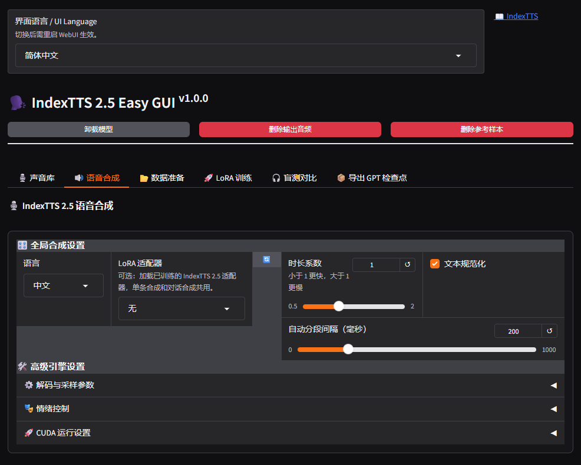

# IndexTTS 2.5 Easy GUI

简体中文 | [English](docs/README.en.md)

一个在 Windows 本地运行的 [IndexTTS 2.5](https://github.com/index-tts/index-tts) 图形界面。除了用参考音频克隆音色、合成语音，还可以整理自己的语料，训练 LoRA，并导出给 ComfyUI 使用。

<!-- 截图待补充：把图片放进 assets/ 后，删掉注释符号，启用下面这一行

-->

## 功能

- **声音库**：上传或录制参考音频，保存后可反复使用。
- **语音合成**：单条合成和多角色对话合成；支持长文本自动分段，可用参考音频、情绪向量或文字描述控制情绪。
- **数据准备**：用 SenseVoice 在 CPU 上为语料补全文本，再逐条听音校对。
- **LoRA 训练**：用自己的语料微调 GPT 模块（实验性功能），支持检查点、续训、评估音频和 TensorBoard。
- **盲测对比**：盲听比较两个适配器（或原始模型），按评分统计偏好和显著性，判断新 LoRA 是变好还是变差。
- **导出 GPT 检查点**：把 LoRA 合并成完整的 `.pth`，可以在 ComfyUI 的 IndexTTS-2.5 节点中加载。
- **一键更新**：不需要 Git，下载新版本、保留个人数据，出问题可以回滚。

界面默认简体中文，可切换为 English。

## 系统要求

- Windows 10/11 x64
- NVIDIA 显卡及驱动（必需；仅语料识别使用 CPU）
- 首次安装和首次启动需要联网，以下载运行环境和模型

维护者的测试环境如下，训练和推理都没有出现显存不足。这只是参考，不是最低要求：

| CPU | 内存 | 显卡 |
| --- | --- | --- |
| Intel i7-10700 | 64 GB DDR4 | NVIDIA RTX A3000LP 12 GB（Ampere） |

显存和内存占用随音频长度、合成设置和训练参数变化。

## 快速开始

1. 下载本项目，双击 **`1- install.bat`** 安装运行环境。安装程序会把 Python 和所有依赖装进项目目录，不影响系统里已有的 Python。
2. 双击 **`2- run.bat`** 启动。首次启动会自动下载 IndexTTS 2.5 模型，完成后浏览器打开 <http://127.0.0.1:7860>。
3. 如果要使用“数据准备”页的语料识别，还需要另外导入 ASR 程序和模型，见 [安装与配置](docs/installation.md#导入-asr-程序和模型)。

安装、局域网访问、代理等详细说明见 [安装与配置](docs/installation.md)。

## 训练自己的音色

```text
准备切片音频 → 识别缺失文本 → 听音校对 → 更新训练清单 → LoRA 训练 → 试听 / 盲测对比 → 导出 GPT 检查点
```

| 步骤 | 说明 |
| --- | --- |
| 准备语料、识别、校对 | [数据准备](docs/user-guide.md#数据准备) |
| 训练与试听 | [LoRA 训练](docs/user-guide.md#lora-训练) |
| 盲听比较新旧权重 | [盲测对比](docs/user-guide.md#盲测对比) |
| 导出到 ComfyUI | [导出 GPT 检查点](docs/user-guide.md#导出-gpt-检查点) |

只想合成语音的话，不需要训练，直接看 [语音合成](docs/user-guide.md#语音合成)。

## 更新

关闭 GUI 后双击 **`3- update.bat`**。模型、语料、训练结果和声音库都会保留。

```powershell
& '.\3- update.bat'             # 更新到最新版本
& '.\3- update.bat' --check     # 只检查，不更新
& '.\3- update.bat' --rollback  # 回到更新前的版本
```

如果新版本改动了依赖，更新会在替换文件前停下，提示你先重新运行安装程序。详见 [更新与常见问题](docs/update-and-troubleshooting.md)。

## 文档

| 文档 | 内容 |
| --- | --- |
| [安装与配置](docs/installation.md) | 安装、启动、ASR 导入、监听地址与代理、加速组件、数据目录 |
| [使用指南](docs/user-guide.md) | 各页面的用法：声音库、语音合成、数据准备、LoRA 训练、盲测对比、导出 |
| [更新与常见问题](docs/update-and-troubleshooting.md) | ZIP 更新、回滚、常见报错的处理 |
| [开发与维护](docs/development.md) | 代码结构、测试、发布清单、版本号、界面翻译 |
| [更新日志](docs/CHANGELOG.md) | 每个版本的变更，以及哪些版本需要重新安装 |

## 致谢与许可

本项目基于 [Mixomo/IndexTTS-2.5-Easy-GUI](https://github.com/Mixomo/IndexTTS-2.5-Easy-GUI) 独立开发维护，保留了原项目的历史、作者信息和许可证。用到或参考的项目：

- [IndexTTS](https://github.com/index-tts/index-tts)：语音合成模型与推理代码。模型原理、论文和评测请查看该仓库。
- [FunASR](https://github.com/modelscope/FunASR) / [SenseVoice](https://github.com/FunAudioLLM/SenseVoice)：语音识别程序与模型。
- [Triton for Windows](https://github.com/triton-lang/triton-windows)、[FlashAttention](https://github.com/Dao-AILab/flash-attention) 及其 [Windows wheels](https://github.com/kingbri1/flash-attention)：可选的推理加速组件。
- [Voice Clone Studio](https://github.com/FranckyB/Voice-Clone-Studio)：界面与工作流的设计参考。

使用和分发须遵守 [LICENSE](LICENSE)（[中文版](LICENSE_ZH.txt)）、[DISCLAIMER](DISCLAIMER)，以及各第三方程序和模型自身的许可。本项目的修改不代表原模型权利人的认可或担保。
