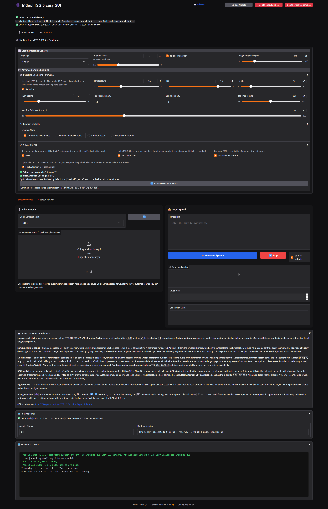
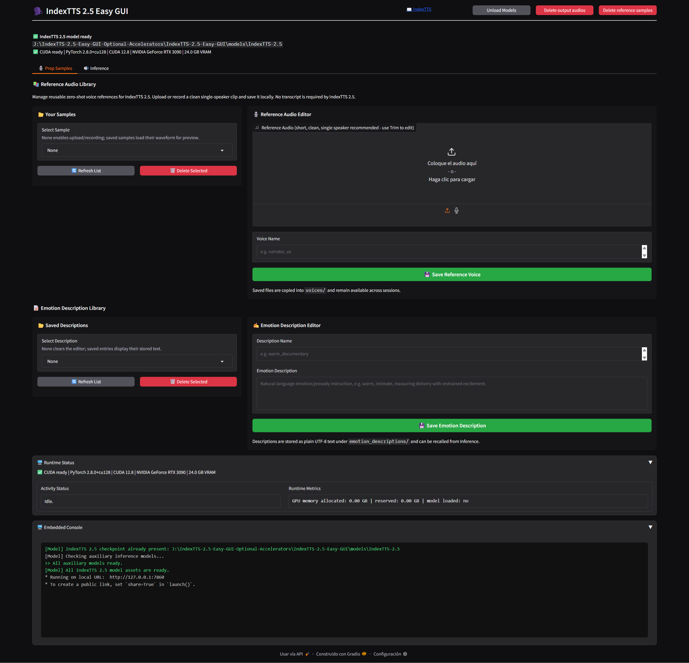
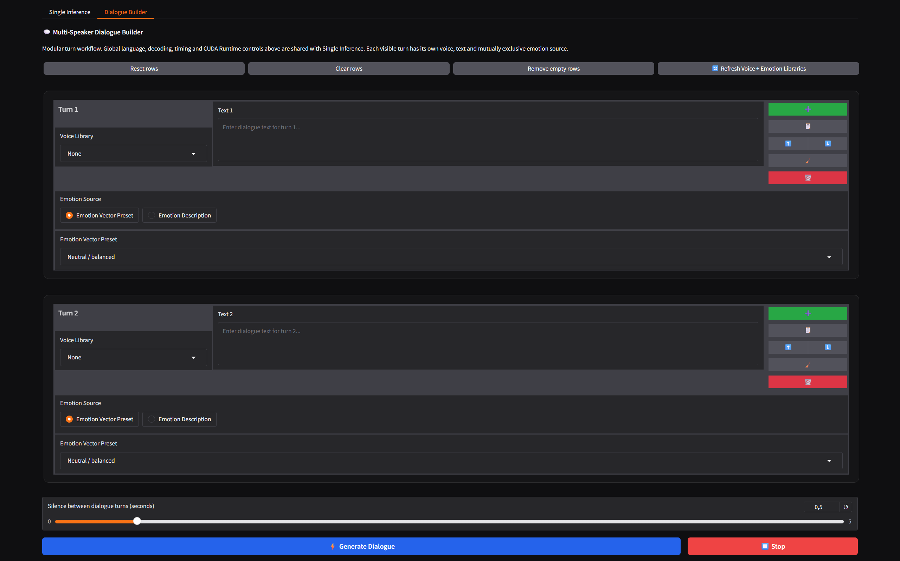
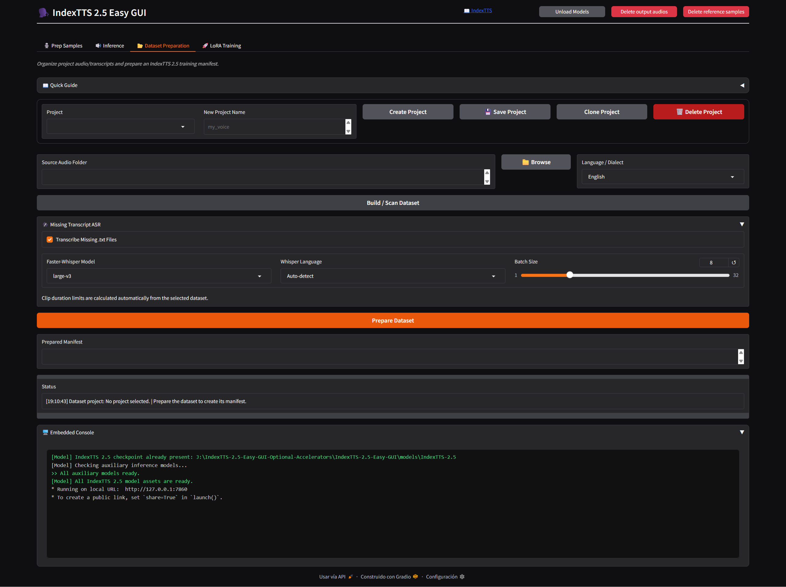
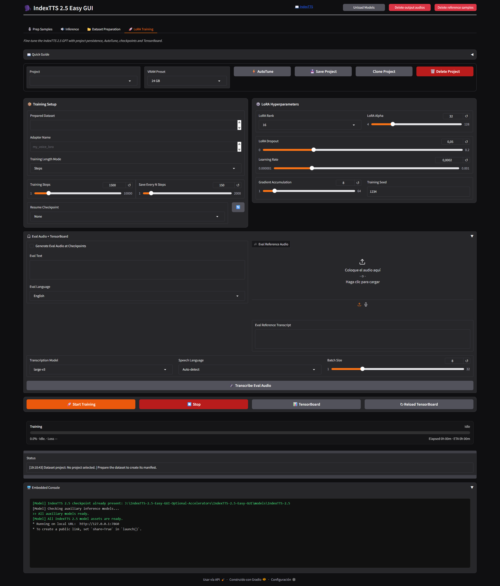

# IndexTTS 2.5 Easy GUI

A Windows GUI for **IndexTTS 2.5** with voice cloning, reusable voice and emotion libraries, multilingual synthesis, detailed emotion control, Dialogue Builder, CUDA acceleration controls, automatic model downloads, progress reporting, and an embedded runtime console.



## Requirements

| Requirement | Minimum |
| --- | --- |
| OS | Windows 10/11 |
| RAM | 32 GB+ |
| VRAM | 12 GB+ |

## Installation

Run:

```bat
install.bat
```

The installer creates the project-local environment and installs the required runtime components and acceleration packages. eSpeak NG is mandatory for the phonetic training path: `espeakng` and the Windows-capable `espeakng-loader` are installed from the project lockfile, and the installer verifies native Spanish IPA generation. A separate system eSpeak installation is not required; when `espeak-ng.exe` is available it remains the preferred fast path. For full text normalization, Windows uses a separate project-local Conda environment containing NeMo Text Processing and the conda-forge Pynini build; the main `.venv` remains isolated. If Conda is not already installed, the installer bootstraps Miniforge locally without changing the system PATH. Only if that bootstrap also fails does Spanish fall back to the bundled `num2words` normalizer.

Model weights are downloaded automatically when needed rather than during the initial environment installation.

## Launch

Run:

```bat
run.bat
```

The launcher verifies the environment, checks the required model files, downloads missing assets, and opens the GUI.

The default local address is:

```text
http://127.0.0.1:7860
```

## Voice Library



The **Prep Samples** tab provides a reusable reference-voice library.

You can:

- upload or record a reference sample;
- preview the waveform and listen to saved samples;
- trim samples before saving;
- assign reusable names;
- refresh the library;
- delete saved voices.

Saved voices are stored under:

```text
voices/
```

## Emotion Description Library

Natural-language emotion and delivery instructions can be stored as reusable presets.

Saved descriptions are available from both **Single Inference** and **Dialogue Builder**.

They are stored under:

```text
emotion_descriptions/
```

## Single Inference

Single Inference combines a speaker reference, synthesis text, language selection, emotion conditioning, duration controls, decoding parameters, and runtime acceleration options.

### Emotion modes

IndexTTS 2.5 supports several ways of controlling delivery.

#### Same as Voice Reference

Uses the speaker reference for both voice identity and its natural expressive characteristics.

#### Separate Emotion Reference

Uses one audio sample for speaker identity and another for emotional/prosodic conditioning.

`emo_alpha` controls the strength of the emotion conditioning.

#### Emotion Vector

Provides direct control over the eight IndexTTS emotion dimensions:

```text
[happy, angry, sad, afraid, disgusted, melancholic, surprised, calm]
```

The GUI includes named presets that populate these values and can then be adjusted manually.

#### Emotion Description

Uses natural-language instructions through QwenEmotion.

Descriptions can be written directly or loaded from the Emotion Description Library.

`use_random` can introduce additional emotional variation.

## Dialogue Builder



Dialogue Builder creates multi-speaker and multi-style conversations from modular turns while sharing the global synthesis and runtime settings with Single Inference.

Each turn contains:

- a saved voice;
- dialogue text;
- an emotion source;
- either an Emotion Vector Preset or Emotion Description Library entry.

The emotion source is selected independently for every turn.

### Turn actions

Each row provides quick actions to:

- add a turn;
- clone a turn;
- move it up;
- move it down;
- clear it;
- delete it.

The toolbar also provides controls to reset rows, clear rows, remove empty rows, and refresh the voice and emotion libraries.

Generated turns are assembled into one WAV with configurable silence between turns.

## Generation Controls

### Language

Selects the synthesis language: English, Spanish, Chinese, Japanese and Arabic.

### Duration Factor

Adjusts generated speech duration.

### Text Normalization

Normalizes supported written forms before tokenization. NeMo text processing is available for supported languages and improves handling of content such as numbers, dates, quantities, currencies, and abbreviations.

### Segment Silence

Controls the silence inserted between generated text segments.

### Maximum Text Tokens per Segment

Controls how long each text segment may become before splitting.

## Sampling and Decoding

### Do Sample

Enables stochastic token sampling. Disable it for more deterministic decoding.

### Temperature

Controls sampling randomness. Lower values are more conservative; higher values increase variation.

### Top-P

Limits sampling to the smallest probability mass whose cumulative probability reaches the selected value.

### Top-K

Limits sampling to the highest-probability token candidates.

### Number of Beams

Controls beam-search width when beam search is applicable.

### Repetition Penalty

Discourages repeated token patterns.

### Length Penalty

Adjusts the decoding preference for shorter or longer sequences when applicable.

### Maximum Mel Tokens

Limits the generated acoustic sequence length.

## CUDA Runtime

Runtime options are shared by Single Inference and Dialogue Builder and persist between launches.

### BF16

Uses BF16 where supported to reduce memory use and improve GPU execution efficiency.

### GPT Latent

Enables the GPT latent conditioning path used by IndexTTS 2.5. The bundled compatibility handling aligns temporal dimensions when necessary before residual addition.

### Triton / torch.compile

Enables supported compiled execution paths through Triton to improve the inference speed.

### FlashAttention

Enables FlashAttention2 for supported GPT attention operations to improve the inference speed.

## Progress, Status and Console

Single Inference and Dialogue Builder share a common runtime area.

Generation displays stage-based progress and status information.

The embedded console mirrors runtime output and includes:

- automatic scrolling;
- bounded history;
- colored errors;
- colored warnings;
- progress messages;
- runtime/loading messages;
- completion messages;
- timing and RTF diagnostics.

Runtime metrics also report GPU memory allocation/reservation and model-load state.

## Automatic Model Setup

Required model files are checked when the application starts.

Missing model and auxiliary assets are downloaded automatically and existing files are reused on subsequent launches.

Models are stored under:

```text
models/
```

Generated audio is stored under:

```text
outputs/
```
## Experimental LoRA Training





The GUI includes a **Prepare Dataset → LoRA Training** workflow for experimental PEFT adaptation of the IndexTTS 2.5 autoregressive GPT. The semantic codec, S2Mel, speaker/feature models and BigVGAN remain frozen. The active profile is acoustic-only: it uses IndexTTS's native mel-token reconstruction loss.

Dataset projects use matching audio and same-stem `.txt` transcripts and are written to `training/datasets/<project>/manifest.jsonl`. The manifest records both `text` (target supervision) and `reference_text` (reference-audio conditioning); current preparation initializes them from the same transcript, while older manifests fall back safely to `text`. Missing transcripts can optionally be generated with Faster-Whisper. the optional transcript is saved beside a library sample as a same-stem `.txt` sidecar and is restored whenever that sample is selected.

The training tab provides project selection, VRAM presets, AutoTune, Steps or Epochs, editable LoRA rank/alpha/dropout, learning rate, gradient accumulation, gradient clipping, checkpoint cadence, optional checkpoint evaluation audio, resume, persistent progress/ETA and TensorBoard. The target transcript is retained only as the mandatory conditioning input of the native TTS objective; it is not added as a separate semantic or ASR target. Checkpoints and final adapters are written under `training/outputs/<adapter>/`.

Single Inference also exposes optional **Reference Transcript Conditioning**. The transcript can be typed manually or generated with Faster-Whisper (default `large-v3`). It describes the words spoken in the reference audio; it is not appended to the target text. Newly trained acoustic-only adapters do not learn this optional signal, so it remains inactive for them.

This trainer is experimental and should be validated with short runs and saved checkpoints before committing to long training sessions.

## Credits

### CORE PROJECT

**IndexTTS / IndexTTS 2.5**

Main TTS engine, voice cloning, multilingual synthesis, emotion control, and audio generation.

GitHub: https://github.com/index-tts/index-tts  
Project: https://index-tts.github.io/  
License: bilibili Model Use License Agreement


### WINDOWS ACCELERATION

**Triton for Windows**

Windows Triton runtime used for compatible accelerated execution paths.

GitHub: https://github.com/triton-lang/triton-windows  
Original Project: https://github.com/woct0rdho/triton-windows  
License: MIT


**FlashAttention**

Memory-efficient attention acceleration.

GitHub: https://github.com/Dao-AILab/flash-attention  
License: BSD-3-Clause


**FlashAttention Windows Wheels**

Precompiled Windows FlashAttention wheels used by the installer.

GitHub: https://github.com/kingbri1/flash-attention  
Releases: https://github.com/kingbri1/flash-attention/releases


### GUI & WORKFLOW INSPIRATION

**FranckyB / Voice Clone Studio**

Inspiration for the voice-library, sample-preparation, and multi-speaker workflow.

GitHub: https://github.com/FranckyB/Voice-Clone-Studio


### LICENSE NOTICE

IndexTTS / IndexTTS 2.5 and all third-party components remain subject to their respective upstream licenses.

This project does not replace or supersede any upstream license terms.
